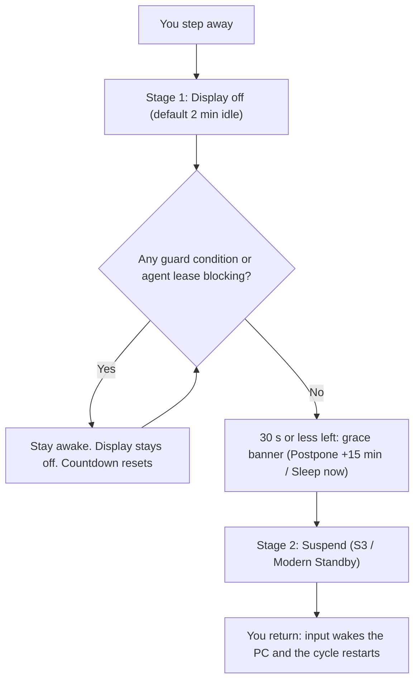
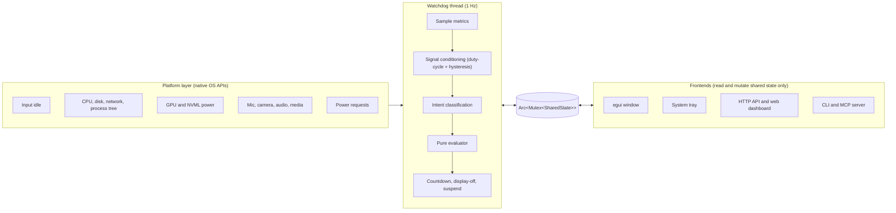

<div align="center">


# Agent Power Guard

### Your PC should sleep when the *work* is done, not when a timer says so.

**A native Rust watchdog that suspends your machine only when you _and_ your background coding agents are truly idle.**<br/>
Claude Code, Cursor, Antigravity, Ollama, long builds, fine-tuning runs: they all finish. Then your PC sleeps.

[](https://github.com/Subham-Maity/agent-power-guard/releases)
[](https://github.com/Subham-Maity/agent-power-guard/actions)
[](LICENSE)


[**Download**](https://github.com/Subham-Maity/agent-power-guard/releases) ·
[**Quick start**](#quick-start-in-60-seconds) ·
[**Why it's different**](#why-agent-power-guard-is-different) ·
[**Architecture**](#architecture-the-smart-parts) ·
[**Agent integration**](#built-for-ai-coding-agents)

<br/>


<br/>

**If this saves you from a killed overnight build, a  star on GitHub helps other developers find it.**

</div>

---

## The problem every developer has hit

You start a long task and walk away. One of two things happens:

| What you set up | What goes wrong |
|---|---|
| **A fixed OS sleep timer** | The machine suspends halfway through `cargo build`, `npm install`, a LoRA fine-tune or a multi-step agent run. Hours of work gone. |
| **"Never sleep" / a keep-awake toggle** | The PC (and its GPU) burns power all night after the work finished, because you forgot to turn it off. |
| **A stuck power request** | An audio driver, a paused browser tab or a download manager holds a `SYSTEM_REQUIRED` lock and your PC never sleeps, and you cannot tell why. |

Operating systems cannot tell *idle* from *busy*. **Agent Power Guard can.**

It replaces the dumb timer with a watchdog that samples the machine every second, understands what is actually happening (you typing, an agent compiling, a call in progress, a movie playing, a model running on the GPU) and suspends the system **only when every enabled condition is quiet.**

---

##  At a glance

| | |
|---|---|
|  **Footprint** | Under **15 MB RAM** in normal use. Roughly **5 MB** once trimmed to the system tray. One native executable. |
|  **Speed** | A dedicated **1 Hz watchdog thread** with allocation-free sampling. The UI repaints at 1 Hz and never touches the decision loop. |
|  **Smarts** | **11 independent guard conditions** + a signal-conditioning layer + an intent state machine. |
|  **Zero bloat** | **No Electron. No WebView. No runtime.** Just Rust, `egui` and native OS APIs. |
|  **Platforms** | Windows 10/11, Linux (X11 and Wayland), macOS (Apple Silicon and Intel). |
|  **Agent-ready** | `run` wrapper, stdio **MCP server**, REST API, and 8 built-in agent profiles. |
|  **Remote control** | QR-paired mobile dashboard, multi-machine fleet view, Wake-on-LAN relay. |
|  **Private** | No telemetry. Token-authenticated local API bound to `127.0.0.1` by default. |
|  **Tested** | Unit tests across the filters, intent logic, parsers and QR encoder, plus scenario-replay tests of the evaluator, run on 3 OSes in CI. |

---

##  Why Agent Power Guard is different

### 1. It understands *intent*, not just activity

Every second the watchdog classifies what the machine is doing, in strict precedence order:

`Best Performance` → `Guard Off` → `Explicit Hold` → `Meeting Live` → `Passive Media` → `Active Work` → `Human Active` → `Idle & Ready`

Stage 1 (display off) and Stage 2 (sleep) are decided independently, so listening to a podcast can turn the screen off without killing the audio, and a muted Zoom call still protects the machine.

### 2. One-second spikes never ruin your countdown

Most tools reset their timer on any blip. Agent Power Guard feeds every analog metric (agent CPU, downloads, whole-PC CPU, disk, network, GPU) through a **rolling-window duty-cycle filter with hysteresis**:

```
Quiet  ──(any sample)──▶  Pending  ──(≥ 8 of 15 s over threshold)──▶  Busy
  ▲                                                                     │
  └──────────────────(≤ 2 of 15 s over threshold)───────────────────────┘
```

- A single huge spike counts as **1 sample**, so it shows as `Pending` and **does not reset the countdown**.
- Real, bursty work that alternates active and idle still crosses the duty-cycle line and holds the machine awake.
- Once `Busy`, it unlatches only when activity clearly drops, so it never flaps.

It is deliberately *not* an EMA: a brief spike cannot artificially extend blocking after it has passed.

### 3. It tells you exactly *why* your PC won't sleep

No more guessing. Every blocker shows **which condition, which process, how much resource, and since when**, with a one-tap **`+ Ignore`** button, in the desktop UI, the tray tooltip and the web dashboard:

```json
{ "condition": 5, "name": "Disk I/O", "who": "cargo.exe", "value": "14.2 MB/s", "since_secs": 18 }
```

A **Block History** tab then answers the question *"what kept my PC awake last night?"*

### 4. It is honest when it cannot see

If a probe is unavailable (for example `powercfg /requests` without admin rights, or no `nvml.dll`), the UI shows an explicit **Probe Unavailable** badge. It never silently reports "idle" or silently blocks.

### 5. It learns your machine

- **Adaptive GPU baseline:** learns your idle desktop-compositor floor and triggers on `floor + margin`, plus NVML board power draw. Static VRAM allocation alone never blocks sleep.
- **Process-tree attribution:** an idle `code.exe` or `cursor.exe` shell does not block sleep, but an active `cargo`, `rustc` or `node` worker it spawned does.
- **Attributed disk and network:** per-process disk I/O bounded by real physical SSD throughput, minus Defender/indexer noise; network measured only on default-route interfaces, ignoring WSL, Hyper-V, Docker and loopback.
- **Adaptive threshold suggestions:** gentle suggestions from idle baselines. It never silently edits your config.

### 6. It is genuinely lightweight

| | Agent Power Guard | A typical Electron utility |
|---|---|---|
| Runtime | Native Rust binary | Bundled Chromium + Node |
| Memory | Under 15 MB (about 5 MB in tray) | Commonly 100 MB or more |
| Renderer | `glow` (OpenGL), repaint throttled to 1 Hz | Full browser engine |
| Startup | Single executable, no runtime to boot | Browser engine startup |
| Remote dashboard | One static HTML file, no build step, no CDN | Usually a separate web stack |

---

##  Quick start in 60 seconds

1. **Download** the installer for your OS from the [Releases page](https://github.com/Subham-Maity/agent-power-guard/releases).
2. **Launch** the app and pick the **15s Test** preset.
3. **Take your hands off** the mouse and keyboard. Watch the live countdown. Any condition marked **BLOCKING SLEEP** lists its exact reason.
4. When all conditions pass and the countdown hits zero, the PC suspends. Move the mouse to wake it; the watchdog restarts its cycle automatically.
5. Switch to a real preset (the default is **3 minutes**) once you like how it behaves.

### Wrap any long task in one command

```bash
agent-power-guard run -- claude
agent-power-guard run -- cargo test --workspace
agent-power-guard run --max-mins 120 --reason "LoRA fine-tuning" -- python train.py
```

The PC stays awake while the task runs, then sleeps shortly after it finishes. If the task crashes, the lease is released within 1 to 2 seconds.

---

##  How it works



Stage 1 turns the display off first (saving power and protecting OLED panels) while CPU, GPU, network and agents keep working. Stage 2 suspends the whole system. Any blocker resets the countdown, and resuming from sleep resets it too, so the machine never suspends again immediately after waking.

---

##  Architecture: the smart parts



### Design decisions that make it fast and smooth

- **The watchdog is independent of the UI.** `eframe` stops running UI code when the window is minimized or the display is off, which is exactly when the sleep timer matters. All timing, sampling and decisions run on a dedicated thread. The GUI, tray, HTTP server and CLI only read and mutate shared state, so closing the window never stops protection.
- **A pure, replay-tested evaluator.** The decision logic is a pure function over a snapshot of the world. That is why it can be covered by scenario-replay tests (idle ready, bursty compile, muted meeting, passive media, zombie lease and more) instead of relying on manual poking.
- **Allocation-free sampling.** One `System`, `Networks` and `Disks` instance is created once and refreshed selectively every second, rather than calling `refresh_all()`.
- **Small memory footprint by design.** The `glow` (OpenGL) renderer instead of `wgpu`, repaints throttled to 1 Hz, and the working set trimmed when the window is hidden in the tray.
- **Native OS APIs, no helper processes.** Windows uses `windows-sys` and `windows` (CoreAudio, WinRT SMTC); Linux and macOS use platform tools and D-Bus. Release builds use fat LTO, one codegen unit, `panic = "abort"` and stripped symbols.
- **Dedicated wake-lock thread.** *Best Performance* mode holds an explicit OS wake lock (`SetThreadExecutionState`, `systemd-inhibit`, `caffeinate`) on its own thread.
- **Network calls never block the loop.** Notifications and update checks run on a separate worker thread, so the 1 Hz watchdog is never delayed.
- **Media locks bind to session identity, not track title.** Playlists never re-prompt on the next song; the lock clears automatically after the pause grace period.
- **Wake classification without disabling wake events.** Resumes are classified as `User Input`, `Scheduled Timer` or `Unattended`, with a short 120 s return-to-sleep timer for unattended wakes.
- **No frontend build step.** The remote dashboard is one static HTML file served by the embedded server.
- **Zero-dependency QR encoder.** `src/qr.rs` is an in-tree encoder (versions 1 to 10, EC levels L and M, byte mode) with unit tests.

| Component | Crate / API |
|---|---|
| GUI | `eframe` / `egui` (glow backend), `egui_plot` |
| System sampling | `sysinfo` |
| Tray | `tray-icon` |
| Serialization | `serde`, `serde_json` |
| Images | `image` (png, ico) |
| Windows APIs | `windows-sys`, `windows` (CoreAudio and WinRT SMTC) |
| Windows packaging | `embed-manifest`, `winres`, WiX Toolset v3 |
| QR codes | in-tree `src/qr.rs` (no dependency) |

---

##  Three modes, one switch

| Mode | What it does |
|---|---|
|  **Smart Guard** | The intent-aware watchdog manages Stage 1 display-off and Stage 2 sleep. *This is the default.* |
|  **Guard Off** | The watchdog pauses and your normal OS power plan takes over. |
|  **Best Performance** | Display and PC stay awake via an explicit OS wake lock, with optional **1h / 2h / ∞** timers. |

Switch from the top control, the tray menu, or `POST /api/operational_mode`.

---

##  Built for AI coding agents

Three ways to integrate, from zero-config to fully scripted:

| Method | Setup | Best for |
|---|---|---|
| **1. `run` wrapper** | Zero config | Any CLI tool, script or agent |
| **2. MCP server** | Paste one config entry | Claude Code, Cursor, Antigravity |
| **3. CLI / REST API** | A line in a script | CI/CD, custom pipelines, batch jobs |

### 1. Process wrapper (recommended)

Ties the lease to the child's PID. The lease is released when the process exits or crashes, `Ctrl+C` terminates the child gracefully and releases the lease, and the child's exit code is forwarded.

```bash
agent-power-guard run -- claude
agent-power-guard run -- cargo test --workspace
agent-power-guard run --max-mins 120 --reason "LoRA fine-tuning" -- python train.py
```

### 2. MCP server

`agent-power-guard mcp` is a stdio Model Context Protocol server. Let the agent decide when to hold the lock:

| Tool | Description |
|---|---|
| `keep_awake(minutes, reason)` | Request a keep-awake lease |
| `release()` | Release the active agent lease |
| `status()` | Countdown, failing blockers and lease details |
| `postpone(minutes)` | Defer automated sleep |

```bash
claude mcp add agent-power-guard -- agent-power-guard mcp
```

Claude Code (`~/.claude.json` or `.claude/config.json`), Cursor (`.cursor/mcp.json`) and Antigravity all accept the same entry:

```json
{
  "mcpServers": {
    "agent-power-guard": {
      "command": "agent-power-guard",
      "args": ["mcp"]
    }
  }
}
```

In Cursor you can instead use **Settings → Features → MCP → + Add New MCP Server** with type `command` and command `agent-power-guard mcp`.

Shell-hook alternative for any agent: run `agent-power-guard lease 60 "Claude agent running"` before a task and `agent-power-guard release` afterwards. See [`docs/agents.md`](docs/agents.md) for the full guide.

### 3. Agent profiles and noise filtering

Select a profile under **Conditions → Watched Agent Processes**:

| Profile | Process names |
|---|---|
| Claude Code | `claude, code` |
| Cursor | `cursor, code, language_server` |
| Antigravity | `antigravity, language_server` |
| Ollama & Local LLM | `ollama, llama, vllm` |
| Docker & Containers | `docker, dockerd, containerd, wsl` |
| Rust / Cargo Toolchain | `cargo, rustc, rust-analyzer` |
| Node / Web Toolchain | `node, npm, pnpm, bun, tsc, esbuild, vite` |
| Python ML | `python, torch, jupyter` |

`ignored_processes` excludes noisy background processes (language-server spikes, Git background indexers, telemetry agents) from resetting the timer. Change it with `POST /api/ignore/add`, `POST /api/ignore/remove`, or the **+ Ignore** button in the dashboard.

### Zombie lease protection

PID-bound leases that sit at about 0% subtree CPU and disk are detected as idle. You get an alert before the optional expiry, so a hung agent cannot hold your machine awake forever.

---

##  Installation

Every release on the [Releases page](https://github.com/Subham-Maity/agent-power-guard/releases) includes the files below plus a `SHA256SUMS.txt` for verification.

| Platform | File | Notes |
|---|---|---|
| Windows 10 / 11 (x64) | `AgentPowerGuard-windows-x64.msi` | Installer with Start Menu and Desktop shortcuts, installs to `C:\Program Files\AgentPowerGuard`. **Recommended.** |
| Windows 10 / 11 (x64) | `agent-power-guard-windows-x64.exe` | Portable single executable. |
| Linux (x86_64) | `agent-power-guard-linux-x86_64.tar.gz` | X11 and Wayland. Contains `agent-power-guard/` with the binary, `README.md` and `LICENSE`. |
| Linux (amd64) | `agent-power-guard_<version>_amd64.deb` | Debian/Ubuntu package with desktop entry, icon and systemd user unit. |
| macOS (Apple Silicon) | `agent-power-guard-macos-aarch64.tar.gz` | M1 and newer. |
| macOS (Intel) | `agent-power-guard-macos-x86_64.tar.gz` | |
| macOS (universal) | `AgentPowerGuard-macos-universal.zip` | `Agent Power Guard.app` bundle (arm64 + x86_64 via `lipo`). |

### Windows

Run the `.msi`, then start **Agent Power Guard** from the Start Menu. Silent install:

```powershell
msiexec /i AgentPowerGuard-windows-x64.msi /qn
```

> **Windows Defender / SmartScreen note:** Release binaries are currently unsigned. When downloading manually in Chrome/Edge, Windows Defender may warn before saving the `.exe` or `.msi` — click **`...` → Keep → Show more → Keep anyway**, and if Windows SmartScreen prompts on first launch, click **More info → Run anyway** (see [Troubleshooting](#troubleshooting) for antivirus folder exclusions).

The executable embeds an application manifest for standard-user execution (`ExecutionLevel::AsInvoker`). The GUI, CLI subcommands (`status`, `lease`, `wol`, `run`, `mcp`, `postpone`) and the background `daemon` all run **without UAC prompts**. `SeShutdownPrivilege` is acquired at runtime when an interactive session triggers sleep.

### Linux

```bash
tar -xzf agent-power-guard-linux-x86_64.tar.gz
cd agent-power-guard
./agent-power-guard
```

Input idle time is read through `xprintidle` under X11 (Wayland sessions query D-Bus first). The tray icon needs GTK 3 and AppIndicator libraries, which most desktop distributions already ship:

```bash
sudo apt install xprintidle   # Debian / Ubuntu
```

### macOS

```bash
tar -xzf agent-power-guard-macos-aarch64.tar.gz
./agent-power-guard
```

On first launch Gatekeeper may block the binary. Open **System Settings → Privacy & Security** and choose **Open Anyway**.

### From source

```bash
cargo install --git https://github.com/Subham-Maity/agent-power-guard
```

### Package managers

Manifests for winget, Scoop, Chocolatey, Homebrew and the AUR are maintained in [`packaging/`](packaging/). Their SHA-256 values are filled in per release, so use the GitHub Releases downloads above if a package manager has not caught up yet.

```bash
winget install SubhamMaity.AgentPowerGuard      # Windows (WinGet)
scoop install agent-power-guard                 # Windows (Scoop)
choco install agent-power-guard                 # Windows (Chocolatey)
brew install subham-maity/tap/agent-power-guard # macOS & Linux (Homebrew)
yay -S agent-power-guard-bin                    # Arch Linux (AUR)
```

### Verify a download

```bash
sha256sum -c SHA256SUMS.txt                       # Linux (shasum -a 256 -c on macOS)
Get-FileHash .\AgentPowerGuard-windows-x64.msi    # Windows (PowerShell)
```

Release binaries are not signed with a paid code-signing certificate (see [Troubleshooting](#troubleshooting)).

---

##  The 11 guard conditions

Each condition can be switched off and tuned independently. The numbering matches the `condN_pass` fields of the HTTP API. Suspend happens only when **every enabled condition passes**.

| # | Condition | Blocks sleep when | Default |
|---|---|---|---|
| 1 | **Human input idle** | Last mouse or keyboard input is more recent than the threshold | 180 s |
| 2 | **Watched agent CPU** | Process-tree worker children matching the watch list exceed the threshold (sustained) | 2.0 % |
| 3 | **Active downloads** | Download managers (`idman`, `aria2c`, `qbittorrent`, `fdm`) exceed the threshold | 100 KB/s |
| 4 | **Whole-PC CPU** | Total CPU minus Agent Power Guard's own CPU exceeds the threshold (sustained) | 30 % |
| 5 | **Attributed disk I/O** | Per-process disk I/O bounded by physical SSD throughput (`IOCTL_DISK_PERFORMANCE`), excluding background noise (`MsMpEng`, `SearchIndexer`, etc.) and browser/WebView IPC, exceeds the threshold | 10,000 KB/s |
| 6 | **Default-route network** | Default-route (`0.0.0.0/0`, `::/0`) throughput exceeds the threshold (ignores WSL, Docker, loopback) | 200 KB/s |
| 7 | **Signal-conditioning filter** | Rolling-window duty cycle + hysteresis across the analog checks (`Busy` ≥ 8/15 s, clears ≤ 2/15 s) | 15 s (8/2) |
| 8 | **Monitor timeout and speaker protection** | Syncs the OS display timeout with Stage 1; skips display-off if HDMI/monitor speakers are playing audio | 2 min |
| 9 | **Power requests** | Active `DISPLAY` locks (suppresses silent paused browser tabs after 60 s; degrades cleanly if unprivileged) | on |
| 10 | **Adaptive GPU activity** | GPU utilization exceeds `max(threshold, idle_floor + margin)` across NVML adapters, plus board power draw | 5 % (+12 % floor margin) |
| 11 | **Mic and camera + signal presence** | Strict on calls (`Zoom`, `Teams`, `Meet`, `Discord`); creative tools (`Premiere`, `OBS`) require an active capture signal | on |

<details>
<summary><b>How the intent engine handles each condition (click to expand)</b></summary>

<br/>

- **Signal-conditioning layer:** Transient 1-second spikes enter `Pending` without resetting the sleep countdown or blocking Stage 1 display-off. Only sustained `Busy` duty cycles block sleep, and hysteresis clears smoothly when quiet.
- **Condition 2** traverses parent-child process trees so idle IDE windows (`code.exe`, `cursor.exe`) don't block sleep by themselves, while active spawned workers and compilers (`cargo`, `node`, `rustc`) do.
- **Conditions 5 and 6** bound per-process disk I/O by physical SSD throughput while excluding antivirus/indexing noise, browser/WebView Mojo IPC and virtual adapters. They show both effective and raw metrics (`proc_rate (Disk total)`) plus top-5 raw I/O diagnostics.
- **Condition 8 and passive media:** Audio-only playback allows Stage 1 display-off while keeping the machine awake (unless playing through monitor/HDMI speakers). Fullscreen or windowed media idle triggers a non-focus-stealing topmost prompt (**Keep Awake / Sleep Now / Hide**) locked to the session identity (`app + session`) until the pause grace expires.
- **Conditions 9 and 10 probe health:** When standard-user privileges block `powercfg /requests`, or `nvml.dll` is absent, an explicit **Probe Unavailable** badge appears instead of a silent misreport.
- **Condition 11** pairs OS mic/camera checks (`CapabilityAccessManager` / PulseAudio) with live CoreAudio peak capture classification (`Dead / Ambient / Active`), so DAWs in standby don't block sleep while muted calls stay protected.

</details>

###  Passive media: watch or listen without fighting your PC

Lying in bed with a video on and the PC idle? CoreAudio render sessions plus WinRT SMTC detect playback and raise a **non-focus-stealing prompt**:

> **Keep Awake · Sleep Now · Hide**

- The choice binds to that player session, not the track title, so playlists never re-prompt.
- Stage 1 still turns the display off to save energy, unless audio is playing through monitor/HDMI speakers.
- Pausing or stopping for longer than the pause grace (default 60 s) clears the lock automatically.

###  Meetings and creative apps, handled differently

- **Calls** (`Zoom`, `Teams`, `Meet`, `Discord`): always protected, even when muted.
- **Creative tools** (`Premiere`, `Resolve`, `Audacity`, `OBS`): block only when real acoustic or camera capture is happening. A DAW sitting in standby with an open mic handle won't keep your PC awake.

---

##  Presets, profiles and schedules

### Timeout presets

| Preset | Sleep after | Display off |
|---|---|---|
| 15s Test | 15 s | 1 min |
| **3m (default)** | 3 min | 2 min |
| 5m | 5 min | 3 min |
| 10m | 10 min | 5 min |
| 15m | 15 min | 10 min |
| 30m | 30 min | 15 min |
| 45m | 45 min | 20 min |
| 1h | 1 h | 30 min |
| 2h / 3h | 2-3 h | 45-60 min |
| Custom | 10 s - 3 h | 1 min - 3 h |

### Timeout profiles

Switch profiles without touching sliders (`POST /api/mode`):

| Mode | Idle | Display timeout | Agent CPU |
|---|---|---|---|
| Balanced (default) | 3 min | 2 min | 2.0 % |
| Work | 10 min | 5 min | 1.0 % |
| Night | 1 min | 1 min | 1.0 % |
| Away | 30 s | 1 min | 1.0 % |
| Custom | user-defined thresholds are preserved | | |

The tray icon's right-click menu switches modes, starts a 1-hour Keep Awake, or postpones sleep (+15 min).

### Quiet hours

Configure automated quiet periods (for example `23:00` to `07:00`). During quiet hours the watchdog downshifts to the aggressive `Night` or `Away` thresholds. **Sleep After Lease Ends** puts the machine to sleep the moment an agent task or wrapped build completes, even overnight.

### Laptop battery awareness

- Detects AC versus battery via `GetSystemPowerStatus` (Windows), `/sys/class/power_supply` (Linux) and `pmset -g batt` (macOS). Desktops without a battery are unaffected.
- **Battery profile:** shorter idle timeout (default 60 s) and tighter CPU limit (default 1.0 %) when unplugged.
- **Emergency low-battery sleep:** forces sleep or hibernate below a critical cutoff (default 15 %).

### Scheduled wake timers

Schedule recurring or one-off wake events (for example `02:00` for a backup or CI job) using native OS facilities: Windows Task Scheduler (`-WakeToRun`), Linux `rtcwake`, macOS `pmset schedule wake`. After waking, the watchdog resumes monitoring and returns the machine to sleep once conditions are idle. Also available as `POST /api/wake_timer/add`.

---

##  Remote dashboard

A responsive, mobile-first dashboard is built into the app (`assets/dashboard.html`: one static file, no build step, no external scripts or CDNs). Enable LAN access from the **Web & Mobile Remote** tab.

- **QR pairing.** The tab renders a QR code that opens the dashboard with the token pre-loaded in the URL fragment (`#t=<token>`). The dashboard stores the token in browser `localStorage` and removes it from the address bar. The pairing URL grants full remote control: do not share or publish screenshots of the QR code.
- **Installable web app.** A web app manifest, icons and mobile viewport tags allow **Add to Home Screen** on Safari and Chrome. For HTTPS outside your LAN, use Tailscale Serve: `tailscale serve https / http://127.0.0.1:49281`.
- **Live sparklines.** 120-second rolling trends for agent CPU, GPU, whole-PC CPU and network, drawn as inline SVG.
- **Active processes with 1-tap ignore.** The top 8 processes by CPU are listed; agent-keyword matches are badged. **+ Ignore** appends a process to the ignore list with no restart.
- **Multi-machine fleet.** The **Multi-Machine Fleet** tab lists peers with state badges (`ARMED`, `BLOCKED`, `PAUSED`, `OFFLINE`), countdowns, blockers, CPU/GPU and mode, refreshed every 3 seconds. Peers have a permission (`control` or `view`) and an optional MAC address. `control` peers expose +15m, Sleep and Toggle; peers with a MAC expose Wake-on-LAN.
- **Wake-on-LAN info.** The dashboard shows the PC's LAN IP and MAC address for use with any phone WoL app.

### Remote wake

A sleeping PC cannot serve web traffic. Send a magic packet from another machine on the LAN:

```bash
agent-power-guard wol 00:11:22:33:44:55 192.168.1.255
```

To wake a machine from outside your network, use a Tailscale subnet router, an always-on node (Raspberry Pi, NAS, router) running the relay, or your router's WoL feature. Requirements: WoL enabled in BIOS/UEFI and in the adapter properties, wired Ethernet (Wi-Fi radios power down during sleep), and Windows Fast Startup disabled. Full guide: [`docs/remote-wake.md`](docs/remote-wake.md).

**Wake relay.** `agent-power-guard relay 49282` turns a lightweight device into an authenticated relay serving `GET /relay/status` and token-protected `POST /relay/wake?mac=XX:XX:XX:XX:XX:XX&bcast=...`. The standalone relay runs without the GUI, `egui` or `sysinfo`, at roughly **2-3 MB of RAM**.

---

##  CLI reference

```bash
agent-power-guard lease 30 "Compiling LLVM release"   # hold for 30 minutes
agent-power-guard release                             # release immediately
agent-power-guard status                              # formatted status summary from /api/status
agent-power-guard postpone 15                         # delay sleep by 15 minutes
agent-power-guard sleep                               # suspend now
agent-power-guard wol 00:11:22:33:44:55               # send Wake-on-LAN magic packet
agent-power-guard wol 00:11:22:33:44:55 192.168.1.255 # ... to a specific broadcast address
agent-power-guard daemon                              # headless watchdog (no GUI)
agent-power-guard service install                     # register background autostart service/task
agent-power-guard service uninstall                   # unregister background service
agent-power-guard service status                      # inspect background service status
agent-power-guard relay 49282                         # Wake-on-LAN micro-relay server
agent-power-guard mcp                                 # stdio MCP server
agent-power-guard run [--max-mins N] [--reason TEXT] -- <command>
```

`wol` accepts standard MAC formats (`00:11:22:33:44:55`, `00-11-22-33-44-55`, or `001122334455`) with an optional custom broadcast target (for example `192.168.1.255:9`).

---

##  HTTP API

A local API is served on port `49281`. It binds to `127.0.0.1` and generates a random 256-bit token on first run.

**Authentication.** All `/api/*` endpoints require the token in `Authorization: Bearer <token>` or `X-APG-Token: <token>`. The CLI reads the token from `api_token.txt` (see [Configuration](#configuration-and-data-files)). Missing or invalid tokens return `401 Unauthorized`; IPs exceeding 10 failed attempts per minute return `429 Too Many Requests` (`Retry-After: 60`). Comparison is constant-time to prevent timing attacks. When LAN access is enabled, `/api/*` endpoints and `OPTIONS` preflights emit `Access-Control-Allow-Origin: *` for multi-machine fleet polling; otherwise cross-origin browser requests are rejected with `403`.

| Endpoint | Method | Parameters | Description |
|---|---|---|---|
| `/` | GET | `#t=<token>` | Remote dashboard (token read from the URL fragment) |
| `/api/status` | GET | | Countdown, operational mode, intent, structured blockers, media/mic/GPU/power-request telemetry, leases |
| `/api/operational_mode` | POST | `mode=smart_guard\|guard_off\|best_performance&hours=N` | Switch top-level operational mode (optional expiry hours for Best Performance) |
| `/api/media_prompt` | POST | `action=keep\|sleep\|hide` | Respond to an active passive-media prompt |
| `/api/guide` | GET | | Built-in `(i)` Guide sections explaining modes, intent and signal conditioning |
| `/api/sleep` | POST | | Suspend immediately |
| `/api/postpone` | POST | `mins=15` | Postpone sleep |
| `/api/toggle_guard` | POST | | Toggle between `Smart Guard` and `Guard Off` |
| `/api/lease` | POST | `mins=30&reason=Build&pid=1234` | Grant a sleep lease (optionally PID-bound with zombie detection) |
| `/api/release` | POST | | Clear all leases |
| `/api/mode` | POST | `name=balanced\|work\|night\|away` | Switch timeout preset profile |
| `/api/schedule/stay_awake` | POST | `mins=60` | Schedule a temporary keep-awake |
| `/api/wake_timer/add` | POST | `time=02:00&label=Backup` | Schedule an OS RTC / Task Scheduler wake timer |
| `/api/wake_timer/delete` | POST | `id=<timer_id>` | Delete a scheduled wake timer |
| `/api/history` | GET | | Recent block-reason history and wake records |
| `/api/history/clear` | POST | | Clear block-reason history |
| `/api/ignore/add` | POST | `process=<name>&kind=process\|disk_noise\|power_owner` | Add a target to the process, disk-noise or power-request ignore list |
| `/api/ignore/remove` | POST | `process=<name>` | Remove a process keyword from the ignore list |
| `/api/peers` | GET | | Configured fleet peers |
| `/api/peers/add` | POST | `name=&url=&token=&permission=&mac=` | Add or update a fleet peer |
| `/api/peers/remove` | POST | `id=<peer_id>` | Remove a fleet peer |
| `/api/wol` | POST | `mac=&bcast=` | Broadcast a Wake-on-LAN magic packet |
| `/api/notify/test` | POST | | Send a test notification on all configured channels |
| `/api/energy/clear` | POST | | Clear energy history |

<details>
<summary><b>Example <code>/api/status</code> response and extra fields</b></summary>

<br/>

```json
{
  "guard_enabled": true,
  "operational_mode": "smart_guard",
  "intent": "ActiveWork",
  "intent_label": "Active Work (cargo.exe)",
  "all_conditions_pass": false,
  "countdown_secs": 180,
  "countdown_max": 180,
  "blocker_banner_text": "Blocked by Attributed Disk I/O (cargo.exe)",
  "structured_blockers": [
    { "condition": 5, "name": "Disk I/O", "who": "cargo.exe", "value": "14.2 MB/s", "since_secs": 18, "ignore_target": "cargo.exe", "ignore_kind": "disk_noise" }
  ],
  "live_idle_secs": 42,
  "live_agent_cpu": 4.8,
  "agent_lease_active": false
}
```

Other fields consumed by the bundled dashboard: `operational_mode_note`, `stage1_display_off_allowed`, `defer_display_off_for_monitor_audio`, `media` (`prompt_active`, `app`, `title`, `lock_active`, `lock_app`), `mic_cam` (`mic_active`, `cam_active`, `app`, `signal_state`, `capture_peak`), `power_requests` (`display_active`, `suppressed_browser`, `unavailable`, `owners`), `gpu` (`util_pct`, `floor_pct`, `effective_threshold_pct`, `power_mw`, `unavailable`), `raw_pc_disk`, `raw_pc_net`, `top_disk_proc`, `top_disk_kbps`, `top_io_debug`, `suggested_thresholds` (`pc_cpu`, `disk_kbps`, `net_kbps`), `agent_lease_reason`, `agent_lease_remaining_secs`, `cond1_pass` through `cond11_pass`, `live_agent_proc`, `live_gpu`, `live_download`, `live_mic_cam_active`, `live_mic_cam_app`, `live_pc_cpu`, `live_pc_disk`, `live_pc_net`, `cond7_text`, `spike_counter`, `spike_limit`, `power_request_active`, `power_mode`, `local_ip`, `mac_address`, `currency_symbol`, `co2_factor`, `history` (`agent_cpu`, `gpu`, `pc_cpu`, `pc_disk`, `pc_net` arrays), `top_processes` and `energy` (`cost_saved`, `kwh_saved`, `duration_secs`, `co2_saved`).

</details>

**curl**

```bash
TOKEN=$(cat ~/.config/agent-power-guard/api_token.txt)
curl -X POST -H "Authorization: Bearer $TOKEN" "http://127.0.0.1:49281/api/lease?mins=45&reason=Build"
curl -H "Authorization: Bearer $TOKEN" http://127.0.0.1:49281/api/status
curl -X POST -H "Authorization: Bearer $TOKEN" http://127.0.0.1:49281/api/release
```

**Python** (Windows uses `%APPDATA%`; elsewhere `~/.config`)

```python
import os
import urllib.request
from pathlib import Path

appdata = os.environ.get("APPDATA")
token_path = (
    Path(appdata) / "AgentPowerGuard" / "api_token.txt"
    if appdata
    else Path.home() / ".config" / "agent-power-guard" / "api_token.txt"
)
token = token_path.read_text().strip()

base = "http://127.0.0.1:49281"
headers = {"Authorization": f"Bearer {token}"}

req = urllib.request.Request(f"{base}/api/lease?mins=45&reason=PyTorch+Training", data=b"", headers=headers)
urllib.request.urlopen(req)

# ... run long job ...

req = urllib.request.Request(f"{base}/api/release", data=b"", headers=headers)
urllib.request.urlopen(req)
```

---

##  Background service and packaging

### Headless service and UI split

```bash
agent-power-guard daemon              # run the watchdog without the GUI
agent-power-guard service install     # Windows Scheduled Task / Linux systemd / macOS launchd
agent-power-guard service uninstall
agent-power-guard service status
```

In service mode, closing the GUI does not stop the watchdog; protection persists across logoff and window close.

### Linux and Wayland

- Idle detection queries `org.freedesktop.ScreenSaver` over D-Bus and `systemd-logind` session hints on GNOME, KDE Plasma and wlroots, falling back to `xprintidle` under X11.
- Systemd user unit: `packaging/systemd/agent-power-guard.service`. It runs `/usr/bin/agent-power-guard daemon` for `.deb` installs; for a standalone binary in `~/.local/bin`, switch `ExecStart` to `%h/.local/bin/agent-power-guard daemon`. Enable with `systemctl --user enable --now agent-power-guard`.
- `packaging/build-deb.sh` builds the `.deb` (binary, XDG desktop entry, 32x32 icon, systemd unit).

### macOS

- `packaging/launchd/com.agentpowerguard.watchdog.plist` runs `/usr/local/bin/agent-power-guard daemon` at load with `KeepAlive`; install the binary there first. Logs go to `/tmp/agent-power-guard.stdout.log` and `.stderr.log`.
- `packaging/build-macos-app.sh` bundles `Agent Power Guard.app` (minimum macOS 11.0) and creates a universal binary with `lipo` when both architecture builds exist.

---

##  Energy tracking

The **Energy & Cost Savings** tab measures real wall-clock standby durations (`before_sleep` to `after_sleep`) and calculates saved electricity, money and CO₂ across sleep sessions and monitor-off events. Filter by today, 7 days, this month, this year or all time.

- **Configurable wattage & high tariff range:** Active Power (`W`), Monitor Power (`W`), Sleep Power (`W`) and Electricity Rate (`0.01` to `50,000` per kWh, supporting `₹9/kWh`+ and high-unit currencies).
- **26 built-in currencies + Custom symbol:** Supports `INR (₹)`, `USD ($)`, `EUR (€)`, `GBP (£)`, `JPY (¥)`, `CAD (C$)`, `AUD (A$)`, `CHF`, `CNY`, `KRW`, `SGD`, `HKD`, `NZD`, `SEK`, `NOK`, `PLN`, `BRL`, `MXN`, `ZAR`, `AED`, `SAR`, `TRY`, `PHP`, `THB`, `VND`, `IDR`, plus any user-entered custom currency symbol or code.
- **Daily Power Projections:** Shows live active vs display-off vs sleep draw, daily protected usage cost, and estimated daily / monthly / yearly savings right on the dashboard.
- **Hardware Watt Calculator & AI Prompt Estimator:**
  1. **Fetch System Specs (Windows, Linux & macOS) as Editable Color-Coded Bubbles:** Unprivileged cross-platform hardware detection scans OS/chassis type, motherboard/system model, CPU cores/threads, RAM module count/DDR type/MHz (`Win32_PhysicalMemory`, `lshw`, `system_profiler`), physical storage drive models & bus/media types (`MSFT_PhysicalDisk`/`NVMe`/`SATA`/`USB` via CIM on Windows, `lsblk`/`sysfs` on Linux, `SPNVMeDataType`/`SPSerialATADataType` on macOS), GPU & VRAM (`AdapterRAM`/registry 64-bit VRAM, `nvidia-smi`/DRM, `SPDisplaysDataType`), displays, Wi-Fi/LAN adapters, Bluetooth devices, audio/mic/USB DAC endpoints, USB peripherals, and motherboard/USB RGB controllers. Every category renders as distinct color-coded pills where you can click to edit, click `x` to remove unused items, or click `+ Add` to append custom hardware.
  2. **Cabinet Fans, ARGB Lighting & Custom Distribution:** Specify unknown case/SMPS specs directly — SMPS wattage & 80+ efficiency, cabinet fan count, ARGB/RGB fan count, CPU cooler type (Air / 120–360mm AIO / Custom Loop), ARGB hubs/LED strips, monitor count/models/per-display watts, optional wall-meter override, quick-add chips, daily active/idle hours, and per-component idle watts (`CPU`, `GPU`, `Board/RAM/Fans/SSD`, `Extras`, `Sleep`).
  3. **Zero-API AI Prompt Workflow:** Generates a copy-ready hardware prompt you can paste into any AI chat (ChatGPT, Claude, Gemini); paste the returned JSON reply directly into the app's input field to auto-apply watts, currency and electricity rate.
- **Local storage:** Defaults start at 150 W active, 50 W display, 3 W sleep (`$0.15`/kWh). Recording can be toggled off anytime; data stays in local `energy_history.json`.

**Regional carbon intensity.** Select a grid profile or enter a custom g/kWh value:

| Profile | g CO₂ / kWh |
|---|---|
| US Average | 368 |
| US California (CAMX) | 205 |
| US Texas (ERCO) | 380 |
| European Union | 230 |
| United Kingdom | 148 |
| Germany | 380 |
| France | 52 |
| India | 713 |
| Australia | 510 |
| Global Average | 436 |
| Custom | user-defined |

The desktop app and the remote dashboard both display savings and `co2_saved` using your configured currency symbol and grid factor.

---

##  Block-reason history

The **Block History** tab shows what prevented sleep:

- **Top blockers leaderboard:** processes and conditions ranked by cumulative hold time (for example `Agent CPU: 2h 15m`).
- **"Last Night" summary:** the overnight 12-hour window, with total blocked time, the dominant blocker and the timestamp sleep was reached.
- **Event timeline:** start time, duration, primary condition and concurrent blockers per event.
- **Export:** CSV or JSON in one click; clear anytime (`POST /api/history/clear`).
- **Storage:** JSON Lines in `block_history.jsonl`, size-based rotation at a 5 MB cap, configurable retention (default 14 days).

---

##  Autonomous Power, Sleep & Media Diagnostic Engine

The **Test & Report** tab runs an autonomous multi-phase diagnostic suite that validates sleep countdowns, tests audio render & microphone capture pipelines, inspects OS `DISPLAY` keep-awake assertions, ramps synthetic workload pressure, executes reverse sleep prevention tests, verifies revert pressure recovery, and profiles real-time watt drops.

### Diagnostic Duration Presets:
- **120 Seconds (2 Minutes) Rapid Diagnostic:** Fast verification of idle baseline, synthetic pressure, reverse sleep test, primary video stream keep-awake assertions, audio endpoints, and sleep triggers.
- **300 Seconds (5 Minutes) Deep Precision Diagnostic [Recommended]:** Complete precision trace: idle baseline calibration, autonomous coding agent compilation & disk pressure, reverse sleep test, revert pressure recovery, dual-tab media playback, background microphone & audio endpoint isolation, driver assertion deep-dive, and full watt drop curve.

### Automated Test Phases:
1. **Pre-Flight Consent & Arming:** Requires hands off mouse and keyboard to observe natural system idle behavior. Guaranteed safe: does NOT physically black out screens or suspend your PC; it captures real system-level trigger events (`display_off_simulated` and `sleep_simulated`) and queries power assertions.
2. **Baseline Idle & Calibration:** Verifies 0 human input, monitors baseline CPU/GPU/Disk activity, and tracks sleep countdown progression.
3. **Synthetic Workload Pressure & Reverse Sleep Test:** Ramps controlled in-process synthetic pressure simulating an Autonomous AI Coding Agent (AST compilation bursts and scratch disk cache writes) and video rendering (Premiere Pro vector compute). Mid-phase, simulates an OS sleep request / zero-countdown condition and verifies that SmartGuard actively intercepts and refuses sleep, guaranteeing running builds and renders are never killed!
4. **Revert Pressure & Recovery Check:** Terminates synthetic pressure and verifies that CPU/GPU drop back to baseline (<8%) and that the watchdog countdown resumes cleanly without orphaned threads or zombie locks.
5. **Primary Media Stream Playback:** Automatically launches a 4K test video in your browser. Verifies whether CoreAudio/WASAPI render hooks and OS `DISPLAY` keep-awake requests activate. (Diagnoses why laptops sleep while watching movies!).
6. **Secondary Background Media Stream:** Automatically opens a secondary background media stream (lofi radio) to test multi-stream audio mixing and background keep-awake retention.
7. **Audio/Mic Release & Zombie Driver Check:** Tests audio pause/close. Verifies whether speakers and active microphone capture streams release cleanly without lingering zombie sleep locks.
8. **Human Behavior vs Autonomous Agent Analysis & Synthesis:** Verifies that SmartGuard protects background agents purely via kernel process, CPU, and disk metrics without requiring artificial mouse jittering. Synthesizes sensor telemetry, classifies findings (`[CRITICAL]`, `[WARNING]`, `[OK]`), and generates an actionable Markdown report.

### Why Laptops Sleep While Watching Movies:
Many web browsers and media players fail to call Windows `SetThreadExecutionState(ES_DISPLAY_REQUIRED)` while streaming video passively. Because you are watching without touching the mouse or keyboard, Windows assumes you walked away and abruptly puts your laptop to sleep mid-movie! **Agent Power Guard's Smart Guard** monitors active CoreAudio/WASAPI render sessions and SMTC tokens directly at the kernel level, ensuring media playback keeps your screen and machine awake even when players fail to assert power requests.

### Safe 1-Click GitHub Issue Reporting (Zero URL Length Limits):
When the test completes, click **Report Issue on GitHub**:
- The complete, unabridged Markdown diagnostic report (with detailed hardware profile, audio/mic devices, watt breakdown, reverse testing results, and second-by-second timeline) is **automatically copied to your OS clipboard** and saved to disk (`agent-power-guard-diagnostic.md`).
- A safe, pre-formatted issue creation template opens in your browser (**no URL length errors, no PATs, and no API keys required**).
- Simply press **Ctrl+V** (or **Cmd+V**) into the issue body to paste the complete diagnostic data! You can also copy the report directly via **Copy Diagnostic Report** or save it with **Save Report to File**.

---

##  Alerts, in-panel updates and uninstall

The **Alerts & Updates** tab configures notifications, in-app software updates and uninstallation. **No notification channels are configured by default** (`ntfy`, Telegram and webhook fields start empty), and outbound requests go only to destinations you configure. Network calls run on a dedicated worker thread so the 1 Hz watchdog is never delayed.

| Channel | Configuration |
|---|---|
| ntfy | ntfy.sh or a self-hosted server; optional authentication token |
| Telegram | `bot_token` and `chat_id` (Telegram Bot API) |
| Generic webhook | HTTP POST with a JSON payload (Discord, Slack, Home Assistant, custom servers) |

| Event | Trigger |
|---|---|
| Sleep imminent | 30-second pre-sleep warning when all conditions pass |
| Machine blocked long | One condition or agent holds the PC awake longer than N hours (default 2) |
| Lease ended | An agent task or build lease concludes |
| PC resumed | The system wakes from sleep |
| Guard paused long | The master guard stayed disabled longer than N hours (default 2, configurable 1-24 h) |

`POST /api/notify/test` sends a test notification to all configured channels.

**In-panel updates (GitHub Releases API).** Uses GitHub's public `/releases` route to list all published versions with `[LATEST]` and `[INSTALLED]` badges. Clicking **Update Now** downloads the matching platform binary or installer in the background, prompts to **Install & Restart Now**, swaps portable executables cleanly (or runs the MSI installer) and updates the displayed version automatically — no manual browser download needed. Opt-in 24-hour background checking is also supported.

**Built-in uninstaller.** Under **Software Management → Uninstall Software...**, you can cleanly disable startup tasks, remove the registered background service, optionally delete saved config/token/history files, and run the Windows MSI uninstaller or remove the portable binary.

---

##  Configuration and data files

Agent Power Guard needs **zero mandatory environment variables**. All watchdog settings, thresholds, power profiles and the `ignored_processes` list are persisted automatically to `config.json`.

| File | Purpose | Windows | Linux | macOS |
|---|---|---|---|---|
| `config.json` | Watchdog thresholds, profiles and settings | `%APPDATA%\AgentPowerGuard\` | `~/.config/agent-power-guard/` | `~/Library/Application Support/AgentPowerGuard/` |
| `api_token.txt` | 256-bit API auth token (0600 on Unix) | `%APPDATA%\AgentPowerGuard\` | `~/.config/agent-power-guard/` | `~/Library/Application Support/AgentPowerGuard/` |
| `energy_history.json` | Energy tracking data | `%APPDATA%\AgentPowerGuard\` | `~/.config/agent-power-guard/` | `~/Library/Application Support/AgentPowerGuard/` |
| `block_history.jsonl` | Block-reason history (JSON Lines) | `%APPDATA%\AgentPowerGuard\` | `~/.config/agent-power-guard/` | `~/Library/Application Support/AgentPowerGuard/` |

| Network item | Value |
|---|---|
| HTTP API and dashboard port | `49281` |
| Bind address | `127.0.0.1` (LAN access is opt-in from the **Web & Mobile Remote** tab) |
| Wake relay port | passed as an argument (`agent-power-guard relay 49282` in the examples) |
| Wake-on-LAN default | broadcast `255.255.255.255`, UDP port `9` |

---

##  Platform support

| Capability | Windows | Linux | macOS |
|---|---|---|---|
| System sleep | `SetSuspendState` (never disables wake events) | `systemctl suspend` | `pmset sleepnow` |
| Wake locks (*Best Performance*) | Dedicated thread, `SetThreadExecutionState` | `systemd-inhibit` | `caffeinate -d -i` |
| Input idle | `GetLastInputInfo` | `xprintidle` / X11, Wayland D-Bus | `ioreg` (`HIDIdleTime`) |
| Wake classification | `PowerRegisterSuspendResumeNotification` | Resume wall-clock jump + idle heuristic | Resume wall-clock jump + idle heuristic |
| Display timeout | `powercfg` + `SendMessageTimeoutW` (`SC_MONITORPOWER`) + HDMI speaker check | `xset dpms` / Wayland DBus | `pmset displaysleep` |
| GPU monitoring | Multi-adapter NVML (`nvml.dll` + board power) | DRM sysfs | IOAccelerator |
| Audio / media / meeting | CoreAudio render and capture RMS, WinRT SMTC, `ConsentStore` | PulseAudio / PipeWire | CoreAudio |
| Network filtering | `GetIpForwardTable2` + `GetAdaptersAddresses` (default route) | `sysinfo` filtered NICs | `sysinfo` filtered NICs |
| Autostart | Task Scheduler / Startup | `~/.config/autostart` | `~/Library/LaunchAgents` |

---

##  Project structure

```
.
├── Cargo.toml                 package manifest (binary: src/app.rs)
├── build.rs                   Windows manifest (AsInvoker) and icon resources
├── build-msi.ps1              builds the Windows MSI with WiX v3.14
├── generate-icon.ps1          regenerates assets\app.ico (Windows PowerShell, System.Drawing)
├── src/
│   ├── app.rs                 binary entry point, UI, tray, web server, watchdog orchestrator
│   ├── signal.rs              rolling-window signal conditioning, hysteresis, GPU baseline, mic signal classifier
│   ├── intent.rs              operational modes, UserIntent state machine, blocker transparency, (i) Guide content
│   ├── evaluator.rs           pure intent-aware decision evaluator and scenario replay tests
│   ├── probes.rs              OS probes (CoreAudio/SMTC worker, wake-lock thread, wake classifier, NVML, NICs, tree sampler)
│   ├── qr.rs                  dependency-free QR encoder (versions 1-10, EC L/M)
│   ├── watt_calc.rs           custom watt distribution, 26 currencies, AI prompt generator & JSON parser
│   └── main.rs                legacy single-module reference (superseded by src/app.rs)
├── assets/
│   ├── dashboard.html         remote dashboard (single static file)
│   ├── icons/*.svg            README SVG icons
│   └── ...                    app.ico, icon_32.png and other icons
├── docs/
│   ├── agents.md              agent integration guide
│   └── remote-wake.md         Wake-on-LAN guide
├── packaging/                 .deb, macOS .app, systemd, launchd, winget, Scoop,
│                              Chocolatey, Homebrew and AUR manifests
├── wix/                       main.wxs and license.rtf for the MSI
└── .github/workflows/         ci.yml and release.yml
```

---

##  Building from source

Requires a stable Rust toolchain at or above the `rust-version` declared in `Cargo.toml` (currently 1.95).

```bash
git clone https://github.com/Subham-Maity/agent-power-guard.git
cd agent-power-guard
cargo build --release
```

On Linux, install the build dependencies first:

```bash
sudo apt install -y pkg-config libx11-dev libxext-dev libxrandr-dev libxinerama-dev \
  libxcursor-dev libxi-dev libgl1-mesa-dev libglu1-mesa-dev libxss-dev libxkbcommon-dev \
  libwayland-dev xprintidle libgtk-3-dev libayatana-appindicator3-dev
```

Packaging (run after `cargo build --release`):

```powershell
# Windows MSI: requires WiX Toolset v3.14 at C:\Program Files (x86)\WiX Toolset v3.14\bin
.\build-msi.ps1          # writes target\installer\AgentPowerGuard-<version>-x64.msi
```

```bash
mkdir -p dist
bash packaging/build-deb.sh          # Linux: dist/agent-power-guard_<version>_amd64.deb (needs dpkg-deb)
bash packaging/build-macos-app.sh    # macOS: dist/AgentPowerGuard-macos-universal.zip (uses lipo)
```

---

##  Development, CI and releases

CI (`.github/workflows/ci.yml`) runs on pushes and pull requests to `main` (README, LICENSE and `.gitignore` changes are ignored) and on manual dispatch. On `x86_64-pc-windows-msvc`, `x86_64-unknown-linux-gnu` and `aarch64-apple-darwin` it runs:

```bash
cargo check --target <target>
cargo test --target <target>
cargo build --release --target <target>
```

Unit tests cover the pure signal-conditioning filters (`src/signal.rs`), intent classification (`src/intent.rs`), scenario-replay tests and evaluator edge cases (`src/evaluator.rs`, `src/app.rs`), OS request/NIC/IPC-browser parsers (`src/probes.rs`), watt/currency/AI JSON helpers (`src/watt_calc.rs`) and QR encoding (`src/qr.rs`). CI does not build the Intel macOS target, run `clippy` or check formatting.

**Releases.** Pushing a tag matching `v*`, or running the workflow manually with `tag_name`, triggers `.github/workflows/release.yml`. It builds the Windows MSI and portable EXE, the Linux `.tar.gz` and `.deb`, and the macOS `aarch64` and `x86_64` archives plus the universal `.app` zip. It then generates `SHA256SUMS.txt` and publishes a GitHub Release. A code-signing step exists as a placeholder and does not sign anything yet.

<details>
<summary><b>Version bump checklist (for maintainers)</b></summary>

<br/>

The version string is duplicated in `Cargo.toml`, `wix/main.wxs` (`Version="x.y.z.0"`), `packaging/macos/Info.plist`, `packaging/build-deb.sh`, and the winget, Scoop, Chocolatey, Homebrew and AUR manifests. `build-msi.ps1` reads `Cargo.toml` and falls back to `1.3.0`. Package-manager manifests also need real SHA-256 values after release checksums are published.

</details>

---

##  Security

- The API and dashboard bind to `127.0.0.1` by default. Enabling LAN access exposes the dashboard over plain HTTP; use a VPN or Tailscale Serve for access outside your LAN.
- Every `/api/*` request needs the 256-bit token. Treat `api_token.txt`, the pairing URL and the QR code as credentials: they grant control over sleep, leases and power modes.
- `Host` validation protects against DNS rebinding, and cross-origin browser requests are rejected with `403` when LAN access is off (LAN mode permits authenticated fleet polling via CORS).
- The dashboard keeps the token (and, if the peers API is unavailable, fleet peer tokens) in browser `localStorage`. Pair only browsers you trust.
- On Windows the application embeds an `AsInvoker` manifest, so the GUI, CLI and background daemon launch without UAC prompts. Suspend (`SetSuspendState`) requests `SeShutdownPrivilege` as a standard user when local policy allows; `powercfg /requests` probing degrades to a **Probe Unavailable** badge when unprivileged rather than hiding errors.
- **No telemetry.** Outbound requests go only to the notification destinations you configure and, if enabled, GitHub Releases.
- Release binaries are not signed with a paid code-signing certificate.

---

##  Troubleshooting

**The machine never sleeps.** Open the app and look for the condition marked **BLOCKING SLEEP**; it shows the reason. The usual causes are a stuck power request (enable the override in condition 9), a background process matching the watch list (the defaults include broad names such as `code`, `node` and `git`), or a threshold that is too tight for your machine's idle noise. The **Block History** tab and the dashboard's **+ Ignore** button help identify and exclude false positives.

**Antivirus flags or removes the executable.** The app suspends the machine, acquires `SeShutdownPrivilege`, writes a startup entry and polls hardware and registry state. Those are legitimate for a power tool but look similar to suspicious behaviour to heuristic scanners, and the binary is not signed with a paid code-signing certificate. The project is open source and makes no network calls other than those you configure.

> [!NOTE]
> **Windows Defender SmartScreen & Browser Warning:** Because Agent Power Guard is a free open-source tool without an expensive commercial EV certificate, Windows Defender SmartScreen or your browser may say *"Windows protected your PC"* or flag the downloaded `.exe` / `.msi`. Click **"More info"** and choose **"Run anyway"** (or in your browser download bar, select **"Keep anyway"**). All binaries are compiled transparently from public source code on GitHub Actions.

To add an exclusion for the install folder:

- **Microsoft Defender:**
  1. Open **Windows Security → Virus & threat protection → Manage settings**.
  2. Under **Exclusions**, choose **Add or remove exclusions** and add `C:\Program Files\AgentPowerGuard`.
- **Bitdefender Total Security:**
  1. Open Bitdefender → **Protection** tab.
  2. Under **Antivirus**, open **Settings** → **Manage exceptions** → **Add an Exception** → add `C:\Program Files\AgentPowerGuard` (check *On-access*, *On-demand*, *Embedded scripts*).
  3. Under **Advanced Threat Defense**, open **Settings** → **Manage exceptions** → add the same folder (check *Advanced Threat Defense*).
  4. If files were quarantined, go to **Protection** → **Antivirus** → **Quarantine** / **Notifications** and choose **Restore**.

**Linux: idle time is never detected.** Install `xprintidle` (X11). On Wayland the app uses D-Bus and `systemd-logind` hints first.

**Linux: no tray icon.** Install GTK 3 and the AppIndicator libraries (`libgtk-3-dev` and `libayatana-appindicator3-dev` for building; the runtime equivalents otherwise).

**macOS: binary blocked on first launch.** Open **System Settings → Privacy & Security** and choose **Open Anyway**.

**Wake-on-LAN doesn't work.** Check that it is enabled in both the BIOS/UEFI and the adapter properties, that Windows Fast Startup is disabled, and that the PC is on Ethernet rather than Wi-Fi. See [`docs/remote-wake.md`](docs/remote-wake.md).

**Dashboard shows "Authentication Required".** Open the dashboard through the link or QR code from the **Web & Mobile Remote** tab, or paste the contents of `api_token.txt` into the token field.

---

##  Contributing

Bug reports, ideas and pull requests are very welcome.

1. Fork the repository.
2. Create a branch: `git checkout -b feat/my-feature`.
3. Commit your changes: `git commit -m "feat: add my feature"`.
4. Push the branch and open a pull request.

CI builds every pull request on Windows (x64), Linux (x86_64) and macOS (Apple Silicon).

**Good first contributions:** new agent profiles, ignore-list defaults for noisy apps, Linux and macOS probe improvements, translations of the in-app guide, and packaging manifests.

---

##  License

Released under the [MIT License](LICENSE).

---

<div align="center">

### If Agent Power Guard saved you a night of lost work or a month of wasted electricity,<br/>**please consider giving it a  star**. It is the best way to help other developers discover it.

[ **Star on GitHub**](https://github.com/Subham-Maity/agent-power-guard) ·
[ **Download**](https://github.com/Subham-Maity/agent-power-guard/releases) ·
[ **Report an issue**](https://github.com/Subham-Maity/agent-power-guard/issues)

<sub>Built with Rust  by <a href="https://github.com/Subham-Maity">Subham Maity</a>. Native, tiny and fast.</sub>

</div>
